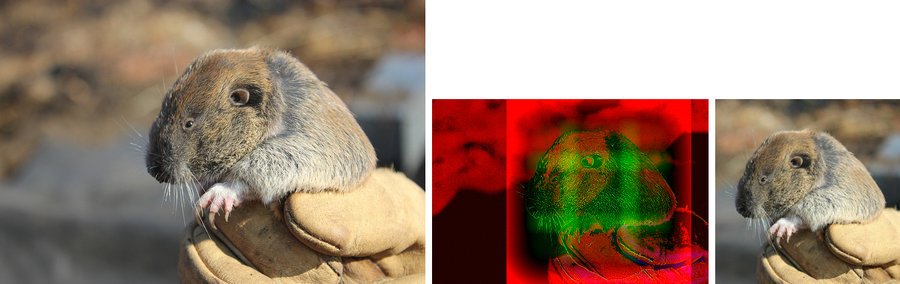
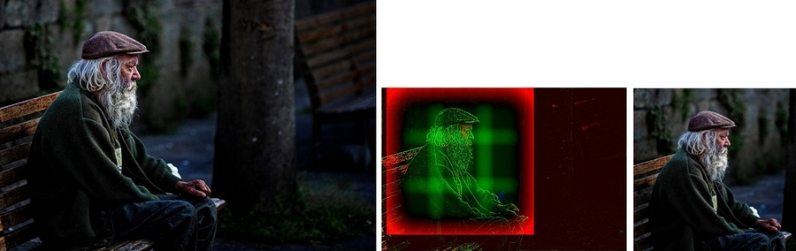

smartcrop
=========

[](https://github.com/muesli/smartcrop/releases)
[](https://github.com/muesli/smartcrop/actions)
[](https://coveralls.io/github/muesli/smartcrop?branch=master)
[](https://goreportcard.com/report/muesli/smartcrop)
[](https://godoc.org/github.com/muesli/smartcrop)

smartcrop finds good image crops for arbitrary sizes. It is a pure Go implementation, based on Jonas Wagner's [smartcrop.js](https://github.com/jwagner/smartcrop.js)


Image: [https://www.flickr.com/photos/usfwspacific/8182486789](https://www.flickr.com/photos/usfwspacific/8182486789) by Washington Dept of Fish and Wildlife, originally licensed under [CC-BY-2.0](https://creativecommons.org/licenses/by/2.0/) when the image was imported back in September 2014


Image: [https://www.flickr.com/photos/endogamia/5682480447](https://www.flickr.com/photos/endogamia/5682480447) by Leon F. Cabeiro (N. Feans), licensed under [CC-BY-2.0](https://creativecommons.org/licenses/by/2.0/)

## Installation

Make sure you have a working Go environment (Go 1.12 or higher is required).
See the [install instructions](https://golang.org/doc/install.html).

To install smartcrop, simply run:

    go get github.com/muesli/smartcrop

To compile it from source:

    git clone https://github.com/muesli/smartcrop.git
    cd smartcrop
    go build

## Example
```go
package main

import (
	"fmt"
	"image"
	_ "image/png"
	"os"

	"github.com/muesli/smartcrop"
	"github.com/muesli/smartcrop/nfnt"
)

func main() {
	f, _ := os.Open("image.png")
	img, _, _ := image.Decode(f)

	analyzer := smartcrop.NewAnalyzer(nfnt.NewDefaultResizer())
	topCrop, _ := analyzer.FindBestCrop(img, 250, 250)

	// The crop will have the requested aspect ratio, but you need to copy/scale it yourself
	fmt.Printf("Top crop: %+v\n", topCrop)

	type SubImager interface {
		SubImage(r image.Rectangle) image.Image
	}
	croppedimg := img.(SubImager).SubImage(topCrop)
	// ...
}
```

Also see the test cases in smartcrop_test.go and cli application in cmd/smartcrop/ for further working examples.

## Configurable analysis

`FindBestCrop` keeps its original signature and behavior. For configurable
analysis scale, target ratio and scoring weights use `NewSettingsAnalyzer`
together with a `Settings` value. Unset fields fall back to the package
defaults through `DefaultSettings()`, so a `Settings` value only needs the
fields it wants to change.

```go
analyzer := smartcrop.NewSettingsAnalyzer(nfnt.NewDefaultResizer())

settings := smartcrop.DefaultSettings()
settings.TargetWidth, settings.TargetHeight = 300, 150
// Analyze at a fixed scale instead of the automatic PrescaleMin rule.
settings.AnalysisScale = 0.5
// Callers can pin every scoring parameter, making runs fully reproducible.
settings.SkinWeight = smartcrop.DefaultSkinWeight

rect, err := analyzer.FindBestCropWithSettings(img, settings)
```

The analysis window is mapped back into the source image's own coordinate
system, including images with non-zero bounds. When only one target dimension
is supplied the other is derived from the source aspect ratio using the same
chop (floor) rounding as the rest of the pipeline.

## Applying a crop

`CropImage` is the reusable cropping entry point. It validates that the
rectangle is canonical, has positive area and lies inside `img.Bounds()`, then
returns the sub-image without modifying the source. `CropImageToSize`
additionally resizes the result to an exact output size.

```go
cropped, err := smartcrop.CropImage(img, rect)
resized, err := smartcrop.CropImageToSize(img, rect, 300, 150, resizer)
```

`ScoreCrop` exposes the skin, saturation and edge scoring on an
original-resolution image, so a window selected at analysis scale can be
verified against a direct full-size score.

## Error semantics

The analyzer returns stable sentinel errors instead of uninitialized or
out-of-bounds rectangles:

* `ErrInvalidDimensions` — negative dimensions or both width and height zero
* `ErrEmptyImage` — source image has no pixels
* `ErrTargetTooLarge` — requested crop does not fit the source bounds
* `ErrZeroSizeAnalysis` — the analysis scale collapses the image to zero size
* `ErrNoCropCandidate` — no legal positive-area candidate window exists
* `ErrCropOutOfBounds` — a crop rectangle escapes the source bounds
* `ErrNilResizer` — a resizing entry point received a nil resizer

All scoring paths are finite: solid black, solid color, transparent and
border-hugging subjects never produce NaN, and repeated or concurrent calls
with the same image and `Settings` return identical rectangles.

## Simple CLI application

    go install github.com/muesli/smartcrop/cmd/smartcrop

    Usage of smartcrop:
      -height int
            crop height
      -input string
            input filename
      -output string
            output filename
      -quality int
            jpeg quality (default 85)
      -resize
            resize after cropping (default true)
      -width int
            crop width

Example:
    smartcrop -input examples/gopher.jpg -output gopher_cropped.jpg -width 300 -height 150

## Sample Data

You can find a bunch of test images for the algorithm [here](https://github.com/muesli/smartcrop-samples).

## Feedback

Got some feedback or suggestions? Please open an issue or drop me a note!

* [Twitter](https://twitter.com/mueslix)
* [The Fediverse](https://mastodon.social/@fribbledom)
